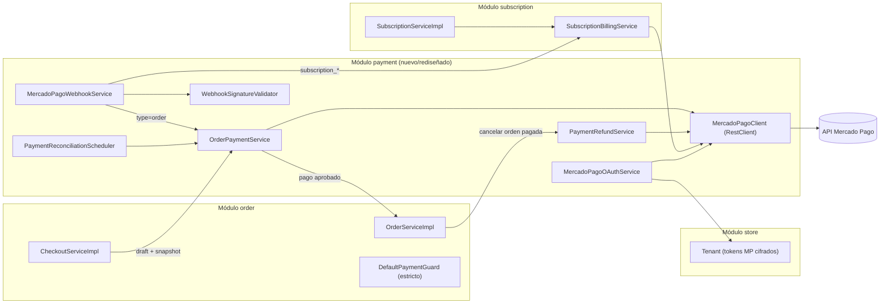
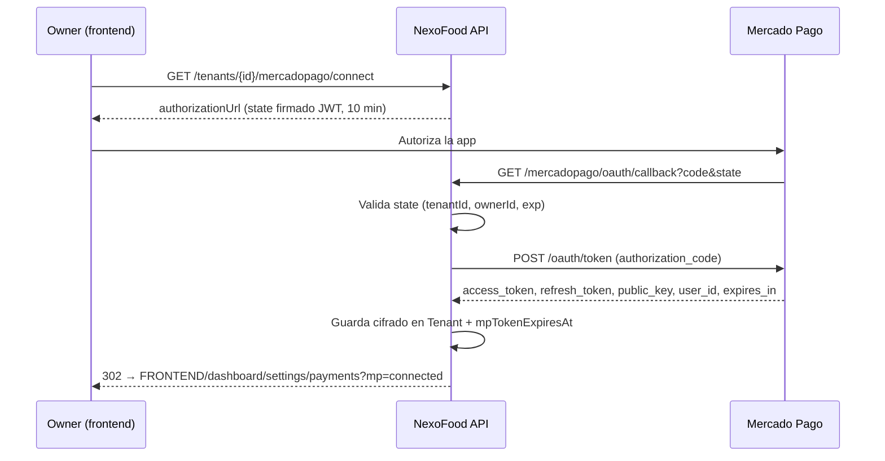
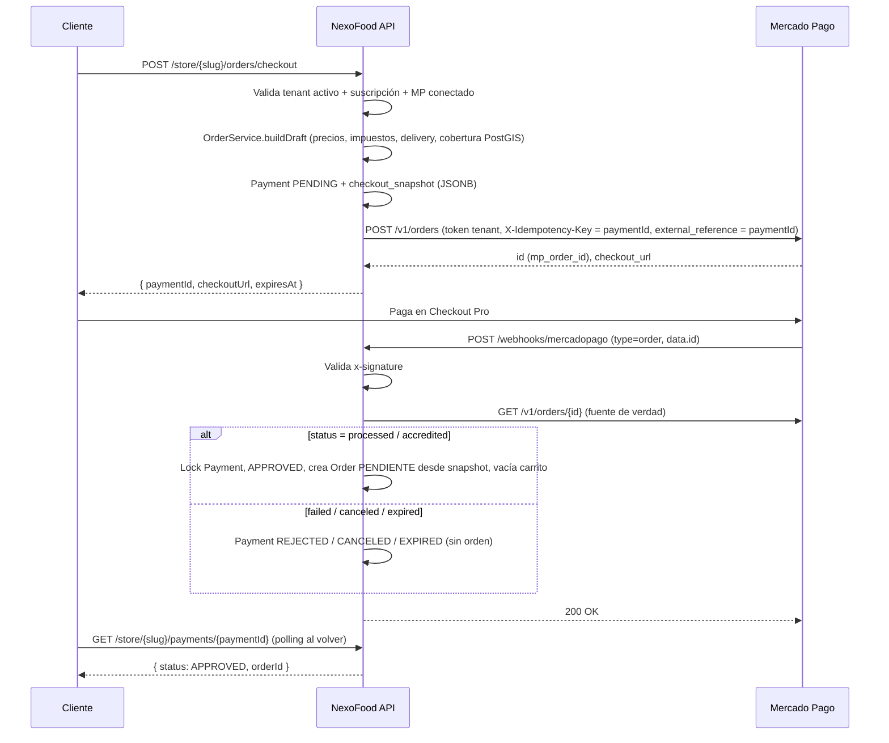
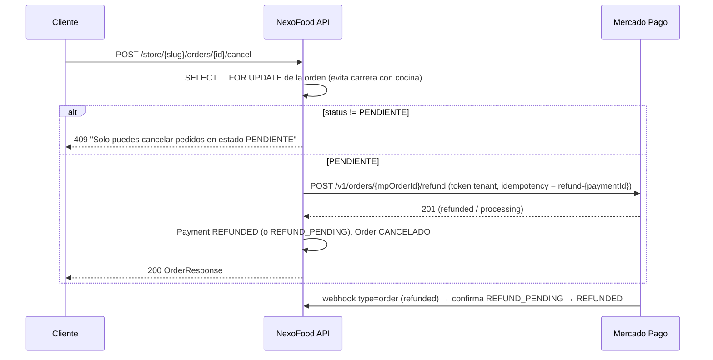
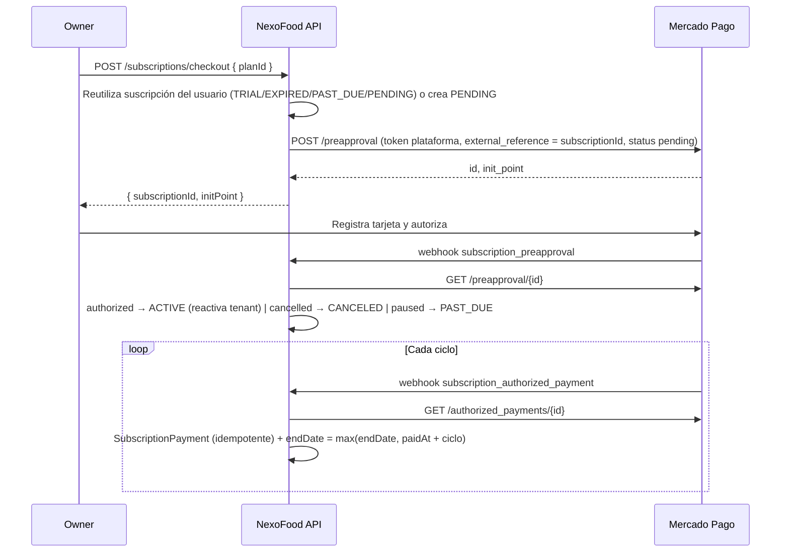

# Plan: Módulo de Pagos con Mercado Pago (Checkout Pro vía Orders API + Suscripciones Preapproval)

## Objetivo

Implementar el módulo `payment` completo y adaptar `order`, `subscription`, `store` y `security` para que:

1. **Suscripción SaaS del tenant** → cobro recurrente con **pagos preaprobados** (`/preapproval`) usando la cuenta de la **plataforma NexoFood**.
2. **Compra del cliente** → **Checkout Pro vía Orders API** (`POST /v1/orders`, `type: online`, `processing_mode: manual`) creada con el **access token OAuth del tenant**, de modo que el dinero llega **directo a la cuenta MP del restaurante**.
3. **La orden (`orders`) solo se genera cuando el webhook confirma el pago aprobado.** Antes de eso solo existe un `Payment` (intento de cobro) con un *snapshot* congelado del carrito.
4. **Cancelación por el cliente con reembolso** (`POST /v1/orders/{id}/refund`) únicamente si la orden sigue en `PENDIENTE`.
5. Un único endpoint público `POST /api/v1/webhooks/mercadopago` con **validación de firma `x-signature`**, que enruta eventos de órdenes, suscripciones y cobros recurrentes.

### Estado actual relevante (hallazgos de la investigación)

| Componente | Estado actual | Impacto |
|---|---|---|
| [Payment.java](file:///home/abdieeel/proyectos/nexofood-api/src/main/java/lat/nexofood/api/modules/payment/domain/Payment.java) | Solo entidad + repo + mapper. `order_id NOT NULL UNIQUE`. Sin service/controller. | Debe rediseñarse: el pago existe **antes** que la orden. |
| [PaymentCreateRequest.java](file:///home/abdieeel/proyectos/nexofood-api/src/main/java/lat/nexofood/api/modules/payment/web/dto/request/PaymentCreateRequest.java) | Acepta `amount` y `rawResponse` del cliente (hallazgo **H8** del ROADMAP). | Se elimina. |
| [Tenant.java](file:///home/abdieeel/proyectos/nexofood-api/src/main/java/lat/nexofood/api/modules/store/domain/Tenant.java) | Ya tiene `mpAccessToken`, `mpRefreshToken`, `mpPublicKey` (cifrados AES-GCM), `mpUserId`, `mpConnectedAt`. Sin flujo OAuth. | Se reutilizan; se agrega `mpTokenExpiresAt`. |
| [CheckoutServiceImpl.java](file:///home/abdieeel/proyectos/nexofood-api/src/main/java/lat/nexofood/api/modules/order/application/service/CheckoutServiceImpl.java) | Crea la orden inmediatamente y vacía el carrito. | Pasa a crear un **intento de pago** y devolver `checkoutUrl`. |
| [DefaultPaymentGuard.java](file:///home/abdieeel/proyectos/nexofood-api/src/main/java/lat/nexofood/api/modules/order/application/service/DefaultPaymentGuard.java) | Permisivo: si no hay pago, deja pasar a `EN_PREPARACION`. | Se vuelve estricto. |
| [OrderServiceImpl.java](file:///home/abdieeel/proyectos/nexofood-api/src/main/java/lat/nexofood/api/modules/order/application/service/OrderServiceImpl.java) | `buildAndSaveOrder` calcula y persiste en un solo paso. | Se separa en **cálculo (draft)** y **persistencia desde draft**. |
| [SubscriptionServiceImpl.java](file:///home/abdieeel/proyectos/nexofood-api/src/main/java/lat/nexofood/api/modules/subscription/application/service/subscription/SubscriptionServiceImpl.java) | Solo `TRIAL`; `mp_preapproval_id` sin usar. | Se agrega facturación con preapproval. |
| [TenantConnectionPreparer.java](file:///home/abdieeel/proyectos/nexofood-api/src/main/java/lat/nexofood/api/common/config/TenantConnectionPreparer.java) | No se usa → RLS inactivo en runtime (H5). | El webhook (sin JWT) **no** queda bloqueado por RLS. Si en Fase 9 se activa RLS, el webhook deberá llamar `setTenantContext` (se deja preparado). |

---

## Revisión requerida

> [!WARNING]
> **Cambio incompatible en `POST /api/v1/store/{slug}/orders/checkout`**: ya **no devuelve `OrderResponse`**, sino `CheckoutPaymentResponse { paymentId, checkoutUrl, amount, currency, expiresAt }`. El frontend debe redirigir a `checkoutUrl` y, al volver, consultar `GET /api/v1/store/{slug}/payments/{paymentId}` hasta obtener `orderId`. El carrito **ya no se vacía en el checkout**, sino cuando el pago se aprueba.

> [!WARNING]
> **Esquema de BD**: la tabla `payments` se **recrea** (hoy no hay ningún servicio que escriba en ella, así que no hay datos productivos que migrar). Se agregan columnas a `tenants` y `subscriptions`, se agrega el estado `PENDING` a suscripciones y una nueva tabla `subscription_payments`. Se entregará script de migración y se actualizará `script.sql`.

> [!IMPORTANT]
> **Requisitos de cuenta Mercado Pago** (fuera del código):
> 1. Una **aplicación** en *Tus integraciones* con OAuth habilitado (`client_id`, `client_secret`, `redirect_uri` registrada).
> 2. **Webhooks** configurados en la aplicación con los tópicos **Order (Mercado Pago)**, **Planes y suscripciones** (`subscription_preapproval`, `subscription_authorized_payment`), y la **clave secreta** de firma.
> 3. **Access token de la plataforma** (cuenta NexoFood) para cobrar las suscripciones.
> 4. Para pruebas: usuarios de prueba (vendedor = tenant, comprador = cliente) y un túnel público (ngrok/cloudflared) para recibir webhooks en local.

> [!CAUTION]
> Se elimina la creación "directa" de órdenes desde el storefront: **toda orden nueva tendrá un pago aprobado**. El `PaymentGuard` pasa a ser estricto: una orden sin pago `APPROVED` no puede pasar a `EN_PREPARACION`. Las órdenes de prueba existentes en BD sin pago quedarían bloqueadas en `PENDIENTE` (solo podrían cancelarse).

---

## Preguntas abiertas

> [!IMPORTANT]
> **P1 – Cancelación por el staff:** Además de la cancelación del cliente (solo `PENDIENTE`), ¿cuando el **restaurante** cancela una orden pagada (en `PENDIENTE` o `EN_PREPARACION`) se debe **reembolsar automáticamente**? *Propuesta: **sí** (si no, el cliente pierde su dinero). Si el reembolso falla en MP, la cancelación no se aplica.*

> [!IMPORTANT]
> **P2 – Comisión de la plataforma (`marketplace_fee`):** `docs/architecture.md` dice "Cero Comisión por Pedido" (100 % al restaurante). *Propuesta: **no enviar `marketplace_fee`**.*

> [!IMPORTANT]
> **P3 – Suscripción tras el TRIAL:** *Propuesta:* si el usuario está en `TRIAL` y se suscribe, el preapproval se crea con `auto_recurring.start_date = fin del trial` (no se le cobra hasta que termine el trial). Si no tiene trial o ya expiró, el primer cobro es inmediato.

> [!NOTE]
> **P4 – Cancelar suscripción pagada [ACORDADO]:**
> Al solicitar la cancelación de una suscripción pagada:
> 1. Se cancela inmediatamente la suscripción en Mercado Pago (`PUT /preapproval/{id}` con `status: cancelled`) para evitar futuros cobros.
> 2. Se marca `cancel_at_period_end = true` en la base de datos manteniendo el estado `ACTIVE`.
> 3. **El restaurante se mantiene abierto y operativo hasta que finalice el período ya pagado (`endDate`).**
> 4. Cuando venza `endDate`, el scheduler existente (`SubscriptionExpirationScheduler`) cambiará el estado a `CANCELED` y desactivará el tenant (`isActive = false`).
> *(Nota: Si la suscripción era `TRIAL` gratuita, se cancela y desactiva inmediatamente).*

> [!NOTE]
> **P5 – Expiración del link de pago del pedido:** *Propuesta: 30 minutos* (`expiration_time = PT30M`, configurable). Evita que un pago en efectivo (PagoEfectivo) se acredite horas después generando una orden de comida "fría".

---

## Dónde configurar las Credenciales y Guía de Túnel (ngrok)

### ¿Dónde colocar las credenciales de Mercado Pago?

En el proyecto existe el archivo template [.env.example](file:///home/abdieeel/proyectos/nexofood-api/.env.example). Para tu entorno de desarrollo local debes tener tu archivo **`.env`** en la raíz del proyecto (`/home/abdieeel/proyectos/nexofood-api/.env`). Este archivo ya está ignorado por git (`.gitignore`), por lo que tus secretos nunca se subirán al repositorio.

Agregaremos y configurarás en tu `.env` las siguientes variables:

```properties
# ==========================================
# Mercado Pago Configuration
# ==========================================
# Credenciales de tu Aplicación en Mercado Pago (Developers -> Tus Integraciones)
MP_CLIENT_ID=tu_client_id_aqui
MP_CLIENT_SECRET=tu_client_secret_aqui

# Access Token de la plataforma (Cuenta NexoFood que cobra las suscripciones)
MP_PLATFORM_ACCESS_TOKEN=APP_USR-tu_token_de_plataforma_aqui

# Secreto de firma de Webhooks (Developers -> Tus Integraciones -> Webhooks -> Clave Secreta)
MP_WEBHOOK_SECRET=tu_webhook_secret_aqui

# OAuth para que los restaurantes conecten su cuenta
# En local usa la URL de ngrok (ver abajo), ej: https://xxxx.ngrok-free.app/api/v1/mercadopago/oauth/callback
MP_OAUTH_REDIRECT_URI=https://tu-url-de-ngrok.ngrok-free.app/api/v1/mercadopago/oauth/callback
MP_OAUTH_STATE_SECRET=secreto_jwt_de_al_menos_32_caracteres_para_state

# URL del Frontend (a donde se redirige al owner/cliente tras pagar o conectar)
FRONTEND_URL=http://localhost:5173
```

---

### ¿Qué es un Túnel y qué es ngrok?

#### El problema con `localhost`:
Cuando desarrollas en tu máquina, tu API corre en `http://localhost:8080`.
Sin embargo, **Mercado Pago corre en los servidores de Mercado Libre en la nube (Internet)**. Cuando un cliente paga o se cobra una suscripción, Mercado Pago necesita avisar a tu sistema haciendo una llamada HTTP (`POST /api/v1/webhooks/mercadopago`).
Mercado Pago **no puede ver ni conectarse a tu `localhost`** porque es una dirección privada de tu computadora.

#### La solución: Un túnel
Un túnel es un puente cifrado y seguro entre Internet y tu máquina local.
**ngrok** es una herramienta muy popular que crea ese túnel:
1. Te asigna una URL pública de internet (por ejemplo: `https://a1b2-c3d4.ngrok-free.app`).
2. Cualquier petición que llegue a esa URL pública en internet, ngrok la reenvía automáticamente a tu puerto local `http://localhost:8080`.

```
[Mercado Pago Webhook] ---> (Internet) ---> [ngrok: https://xxxx.ngrok-free.app] ---> (Tu PC: http://localhost:8080)
```

#### ¿Cómo se usa ngrok para probar en local?
1. Creas una cuenta gratuita en [ngrok.com](https://ngrok.com) y descargas el binario (o lo instalas con `sudo snap install ngrok` o descargándolo).
2. Autenticas tu terminal con tu token de ngrok:
   ```bash
   ngrok config add-authtoken TU_TOKEN_DE_NGROK
   ```
3. Abres el túnel apuntando al puerto de NexoFood:
   ```bash
   ngrok http 8080
   ```
4. ngrok te mostrará en pantalla una URL pública con HTTPS (ej. `https://1234-56-78.ngrok-free.app`).
5. Copias esa URL y la configuras:
   - En tu panel de Mercado Pago Developers -> Webhooks: `https://1234-56-78.ngrok-free.app/api/v1/webhooks/mercadopago`
   - En tu `.env` como `MP_OAUTH_REDIRECT_URI`: `https://1234-56-78.ngrok-free.app/api/v1/mercadopago/oauth/callback`
   *(Nota: También puedes usar alternativas como Cloudflare Tunnels `cloudflared tunnel`, pero ngrok es la más sencilla y estándar).*

---

---

## Arquitectura propuesta



**Tokens usados por cada operación:**

| Operación MP | Token |
|---|---|
| `POST /v1/orders`, `GET /v1/orders/{id}`, `POST /v1/orders/{id}/refund`, `POST /v1/orders/{id}/cancel` | **Access token OAuth del tenant** (dinero al restaurante) |
| `POST/GET/PUT /preapproval`, `GET /authorized_payments/{id}` | **Access token de la plataforma** |
| `POST /oauth/token` | `client_id` + `client_secret` de la aplicación |

---

## Flujos

### Flujo 1 – Conexión OAuth del restaurante



### Flujo 2 – Compra del cliente (Checkout Pro vía Orders API)



### Flujo 3 – Cancelación con reembolso (cliente)



### Flujo 4 – Suscripción con pagos preaprobados



### Mapeo de estados

**Orden MP → `PaymentStatus`**

| MP `status` / `status_detail` | `PaymentStatus` | Acción |
|---|---|---|
| `created` | `PENDING` | — |
| `processing`, `action_required` | `IN_PROCESS` | — |
| `processed` / `accredited` | `APPROVED` | **Crear orden** |
| `failed` | `REJECTED` | — |
| `canceled` / `canceled` | `CANCELED` | — |
| `canceled` / `expired` | `EXPIRED` | — |
| `refunded`, `processed`/`partially_refunded` | `REFUNDED` | Si la orden no está cancelada y es `PENDIENTE` → `CANCELADO` |
| `charged_back` | `CHARGED_BACK` | Log de alerta |

**Preapproval MP → `SubscriptionStatus`**: `pending` → `PENDING` (o se mantiene `TRIAL`), `authorized` → `ACTIVE`, `paused` → `PAST_DUE`, `cancelled` → `CANCELED`.

---

## Cambios propuestos

### 1. Configuración y dependencias

#### [MODIFY] [pom.xml](file:///home/abdieeel/proyectos/nexofood-api/pom.xml)
Sin SDK de MP: el SDK Java no modela completamente `type: online`/`checkout_url` de Orders API. Se usa **Spring `RestClient`** (ya incluido en `spring-boot-starter-webmvc`) → control total de headers (`X-Idempotency-Key`) y JSON. No se requieren dependencias nuevas.

#### [MODIFY] [application.yaml](file:///home/abdieeel/proyectos/nexofood-api/src/main/resources/application.yaml)
```yaml
mercadopago:
  api-base-url: https://api.mercadopago.com
  auth-base-url: ${MP_AUTH_BASE_URL:https://auth.mercadopago.com.pe}
  client-id: ${MP_CLIENT_ID}
  client-secret: ${MP_CLIENT_SECRET}
  platform-access-token: ${MP_PLATFORM_ACCESS_TOKEN}   # cobro de suscripciones
  webhook-secret: ${MP_WEBHOOK_SECRET}
  oauth:
    redirect-uri: ${MP_OAUTH_REDIRECT_URI}             # https://api.nexofood.lat/api/v1/mercadopago/oauth/callback
    state-secret: ${MP_OAUTH_STATE_SECRET}
    refresh-before-days: 30
  currency: PEN
  order-expiration: ${MP_ORDER_EXPIRATION:PT30M}
  reconciliation-cron: "0 */5 * * * *"
  token-refresh-cron: "0 30 3 * * *"
app:
  frontend:
    base-url: ${FRONTEND_URL:http://localhost:5173}
    order-result-path: /store/{slug}/checkout/result
    subscription-result-path: /dashboard/subscription/result
    mp-connect-result-path: /dashboard/settings/payments
```
`application-dev.yaml` tendrá valores por defecto de sandbox (vacíos/placeholder) para que la app arranque sin credenciales.

#### [MODIFY] [.env.example](file:///home/abdieeel/proyectos/nexofood-api/.env.example)
Agregar `MP_CLIENT_ID`, `MP_CLIENT_SECRET`, `MP_PLATFORM_ACCESS_TOKEN`, `MP_WEBHOOK_SECRET`, `MP_OAUTH_REDIRECT_URI`, `MP_OAUTH_STATE_SECRET`, `MP_AUTH_BASE_URL`, `MP_ORDER_EXPIRATION`, `FRONTEND_URL`.

---

### 2. Base de datos

#### [NEW] `docs/migrations/2026-11_pagos_mercadopago.sql` + [MODIFY] [script.sql](file:///home/abdieeel/proyectos/nexofood-api/script.sql)

```sql
-- TENANTS: expiración del token OAuth
ALTER TABLE tenants ADD COLUMN mp_token_expires_at TIMESTAMPTZ;

-- SUBSCRIPTIONS: estado PENDING (checkout iniciado, sin autorizar) + estado MP + cancelación al fin de período
ALTER TABLE subscriptions DROP CONSTRAINT chk_subscriptions_status;
ALTER TABLE subscriptions ADD CONSTRAINT chk_subscriptions_status
    CHECK (status IN ('PENDING','TRIAL','ACTIVE','PAST_DUE','CANCELED','EXPIRED'));
ALTER TABLE subscriptions ADD COLUMN mp_preapproval_status VARCHAR(50);
ALTER TABLE subscriptions ADD COLUMN cancel_at_period_end BOOLEAN NOT NULL DEFAULT FALSE;
CREATE UNIQUE INDEX uk_subscriptions_mp_preapproval_id ON subscriptions(mp_preapproval_id)
    WHERE mp_preapproval_id IS NOT NULL;

-- SUBSCRIPTION_PAYMENTS: historial de cobros recurrentes (idempotencia por authorized_payment)
CREATE TABLE subscription_payments (
    id                        UUID           PRIMARY KEY DEFAULT gen_random_uuid(),
    subscription_id           UUID           NOT NULL REFERENCES subscriptions(id) ON DELETE RESTRICT,
    mp_authorized_payment_id  VARCHAR(100)   NOT NULL UNIQUE,
    mp_payment_id             VARCHAR(100),
    status                    VARCHAR(50)    NOT NULL
        CONSTRAINT chk_subscription_payments_status CHECK (status IN ('PENDING','APPROVED','REJECTED','REFUNDED')),
    amount                    NUMERIC(10, 2) NOT NULL,
    currency                  VARCHAR(3)     NOT NULL DEFAULT 'PEN',
    paid_at                   TIMESTAMPTZ,
    period_end                TIMESTAMPTZ,
    raw_response              JSONB,
    created_at                TIMESTAMPTZ    NOT NULL DEFAULT CURRENT_TIMESTAMP,
    updated_at                TIMESTAMPTZ    NOT NULL DEFAULT CURRENT_TIMESTAMP
);

-- PAYMENTS: se recrea. El pago existe ANTES que la orden (order_id nullable).
DROP TABLE IF EXISTS payments CASCADE;
CREATE TABLE payments (
    id                UUID           PRIMARY KEY DEFAULT gen_random_uuid(),   -- = external_reference en MP
    tenant_id         UUID           NOT NULL REFERENCES tenants(id) ON DELETE RESTRICT,
    customer_id       UUID           NOT NULL,
    order_id          UUID           UNIQUE REFERENCES orders(id) ON DELETE SET NULL,
    mp_order_id       VARCHAR(100)   UNIQUE,
    mp_payment_id     VARCHAR(100),
    checkout_url      TEXT,
    payment_method    VARCHAR(50),
    status            VARCHAR(50)    NOT NULL DEFAULT 'PENDING'
        CONSTRAINT chk_payments_status CHECK (status IN (
            'PENDING','IN_PROCESS','APPROVED','REJECTED','CANCELED','EXPIRED',
            'REFUND_PENDING','REFUNDED','CHARGED_BACK')),
    status_detail     VARCHAR(100),
    amount            NUMERIC(10, 2) NOT NULL,
    currency          VARCHAR(3)     NOT NULL DEFAULT 'PEN',
    checkout_snapshot JSONB          NOT NULL,
    raw_response      JSONB,
    expires_at        TIMESTAMPTZ,
    approved_at       TIMESTAMPTZ,
    refunded_at       TIMESTAMPTZ,
    refund_reason     TEXT,
    created_at        TIMESTAMPTZ    NOT NULL DEFAULT CURRENT_TIMESTAMP,
    updated_at        TIMESTAMPTZ    NOT NULL DEFAULT CURRENT_TIMESTAMP,
    CONSTRAINT payments_tenant_customer_fkey
        FOREIGN KEY (tenant_id, customer_id) REFERENCES tenant_customers(tenant_id, user_id) ON DELETE RESTRICT
);
CREATE INDEX idx_payments_tenant_status   ON payments(tenant_id, status);
CREATE INDEX idx_payments_customer        ON payments(tenant_id, customer_id);
CREATE INDEX idx_payments_status_created  ON payments(status, created_at);   -- reconciliación
-- + trigger updated_at y política RLS tenant_isolation (igual que hoy)
```

---

### 3. Módulo `payment` – Infraestructura Mercado Pago

Nuevo paquete `modules/payment/infrastructure/mercadopago/`:

#### [NEW] `MercadoPagoProperties.java`
`@ConfigurationProperties("mercadopago")` (record) con las propiedades de arriba.

#### [NEW] `MercadoPagoClient.java`
Cliente HTTP único (`RestClient`), sin lógica de negocio:
```java
public interface MercadoPagoClient {
    // Orders API (token del tenant)
    MpOrderResponse createOrder(String accessToken, String idempotencyKey, MpOrderRequest request);
    MpOrderResponse getOrder(String accessToken, String mpOrderId);
    MpOrderResponse refundOrder(String accessToken, String idempotencyKey, String mpOrderId);
    MpOrderResponse cancelOrder(String accessToken, String idempotencyKey, String mpOrderId);
    // Suscripciones (token de plataforma)
    MpPreapprovalResponse createPreapproval(MpPreapprovalRequest request);
    MpPreapprovalResponse getPreapproval(String preapprovalId);
    MpPreapprovalResponse updatePreapprovalStatus(String preapprovalId, String status);
    MpAuthorizedPaymentResponse getAuthorizedPayment(String authorizedPaymentId);
    // OAuth
    MpOAuthTokenResponse exchangeAuthorizationCode(String code);
    MpOAuthTokenResponse refreshToken(String refreshToken);
}
```
- `RestClientMercadoPagoClient` implementa; traduce 4xx/5xx a `PaymentGatewayException` (incluye `status` y `cause` de MP, **sin** loguear tokens).
- Timeouts: connect 5 s / read 15 s.

#### [NEW] DTOs `infrastructure/mercadopago/dto/*` (records con `@JsonNaming(SnakeCaseStrategy)`)
Ejemplo de request de orden (Checkout Pro):
```java
@Builder
public record MpOrderRequest(
        String type,                 // "online"
        String processingMode,       // "manual"
        String totalAmount,          // "45.50" (string, 2 decimales)
        String externalReference,    // paymentId
        String expirationTime,       // "PT30M"
        MpPayer payer,               // { email }
        List<MpItem> items,          // title, unit_price, quantity (sum == total_amount)
        MpConfig config              // { online: { back_urls, auto_return: "approved" } }
) {}
```
Los ítems se envían como **líneas con quantity = 1 y unit_price = subtotal + impuesto de la línea** (título `"2x Hamburguesa clásica"`), más una línea `"Costo de envío"` si `deliveryFee > 0`. Así la suma coincide **exactamente** con `order.total` sin problemas de redondeo (requisito de la Orders API).

#### [NEW] `MercadoPagoWebhookSignatureValidator.java`
```java
// x-signature: "ts=1704908010,v1=618c85..."; x-request-id: "<uuid>"
// manifest = "id:" + dataId.toLowerCase() + ";request-id:" + requestId + ";ts:" + ts + ";"
// (se omiten las partes ausentes, según la doc de MP)
// HMAC-SHA256(manifest, webhookSecret) == v1  → comparación en tiempo constante (MessageDigest.isEqual)
public boolean isValid(String xSignature, String xRequestId, String dataId);
```

#### [NEW] `PaymentGatewayException.java` (en `common/exception`)
Y su handler en [GlobalExceptionHandler.java](file:///home/abdieeel/proyectos/nexofood-api/src/main/java/lat/nexofood/api/common/exception/GlobalExceptionHandler.java) → **502 Bad Gateway** con mensaje amigable.

---

### 4. Módulo `payment` – Dominio

#### [MODIFY] [Payment.java](file:///home/abdieeel/proyectos/nexofood-api/src/main/java/lat/nexofood/api/modules/payment/domain/Payment.java)
- `order` pasa a `nullable`, `@OneToOne` opcional.
- Nuevos: `customerId`, `mpOrderId` (reemplaza `mpPreferenceId`), `checkoutUrl`, `statusDetail`, `currency`, `checkoutSnapshot` (`@JdbcTypeCode(SqlTypes.JSON)` → `OrderDraft`), `rawResponse` (`@JdbcTypeCode(SqlTypes.JSON)`), `expiresAt`, `approvedAt`, `refundedAt`, `refundReason`.
- Métodos de dominio: `markApproved(...)`, `markRefunded(...)`, `isFinal()`, `canBeRefunded()`.

#### [MODIFY] [PaymentStatus.java](file:///home/abdieeel/proyectos/nexofood-api/src/main/java/lat/nexofood/api/modules/payment/domain/PaymentStatus.java)
`PENDING, IN_PROCESS, APPROVED, REJECTED, CANCELED, EXPIRED, REFUND_PENDING, REFUNDED, CHARGED_BACK`

#### [NEW] `MpOrderStatusMapper.java`
Traduce `status`/`status_detail` de MP → `PaymentStatus` (tabla de mapeo de arriba).

#### [MODIFY] [PaymentRepository.java](file:///home/abdieeel/proyectos/nexofood-api/src/main/java/lat/nexofood/api/modules/payment/infrastructure/repository/PaymentRepository.java)
```java
@Lock(LockModeType.PESSIMISTIC_WRITE)
@Query("SELECT p FROM Payment p WHERE p.id = :id")
Optional<Payment> findByIdForUpdate(UUID id);

@Lock(LockModeType.PESSIMISTIC_WRITE)
Optional<Payment> findByMpOrderId(String mpOrderId);   // con @Query FOR UPDATE

Optional<Payment> findByIdAndTenantIdAndCustomerId(UUID id, UUID tenantId, UUID customerId);
List<Payment> findAllByTenantIdAndCustomerIdAndStatusIn(UUID tenantId, UUID customerId, Collection<PaymentStatus> s);
List<Payment> findTop100ByStatusInAndUpdatedAtBefore(Collection<PaymentStatus> s, OffsetDateTime t);
Page<Payment> findAllByTenantId(UUID tenantId, Pageable p);  // + filtro por status
```

---

### 5. Módulo `payment` – Servicios de aplicación

#### [NEW] `MercadoPagoOAuthService` / `MercadoPagoOAuthServiceImpl`
- `buildAuthorizationUrl(tenantId)`: solo OWNER; `state` = JWT HS256 (jjwt ya presente) con `tenantId`, `userId`, `exp = 10 min`, firmado con `mp.oauth.state-secret`.
  URL: `{auth-base-url}/authorization?client_id=..&response_type=code&platform_id=mp&state=..&redirect_uri=..`
- `handleCallback(code, state)`: valida `state`, intercambia `code`, guarda `mpAccessToken`, `mpRefreshToken`, `mpPublicKey`, `mpUserId`, `mpConnectedAt`, `mpTokenExpiresAt = now + expires_in`. Devuelve URL de redirección al frontend (`?mp=connected` o `?mp=error&reason=...`).
- `getStatus(tenantId)`, `disconnect(tenantId)` (limpia credenciales; checkout queda bloqueado).
- `getValidAccessToken(Tenant)`: si `mpTokenExpiresAt < now + 1 día` → refresca en caliente.

#### [NEW] `MercadoPagoTokenRefreshScheduler`
Diario: tenants con `mpTokenExpiresAt < now + 30 días` → `POST /oauth/token (refresh_token)`; MP rota también el `refresh_token`, se guarda el nuevo.

#### [NEW] `OrderPaymentService` / `OrderPaymentServiceImpl`
```java
CheckoutPaymentResponse startCheckout(OrderDraft draft, TenantCustomer customer);
void processMpOrderNotification(String mpOrderId);          // webhook + reconciliación
PaymentStatusResponse getCustomerPaymentStatus(String slug, UUID paymentId);
```
**`startCheckout`** (`@Transactional`):
1. Verifica `tenant.mpAccessToken != null` → si no, `409 "Este restaurante aún no tiene habilitados los pagos en línea"`.
2. Cancela (best-effort en MP + `CANCELED` local) intentos `PENDING` previos del mismo cliente en el mismo tenant → evita pagar dos veces.
3. Persiste `Payment(PENDING, amount = draft.total, checkoutSnapshot = draft, expiresAt)`.
4. `POST /v1/orders` con token del tenant, `X-Idempotency-Key = payment.id`, `external_reference = payment.id`, `back_urls` con `?paymentId=`.
5. Guarda `mpOrderId`, `checkoutUrl`. Si MP falla → excepción 502 y rollback (no queda Payment huérfano).

**`processMpOrderNotification`** (`@Transactional`, idempotente):
1. `findByMpOrderId` **con lock pesimista** (serializa webhooks duplicados/concurrentes). Si no existe → log + return (puede ser de otra integración).
2. `GET /v1/orders/{id}` con token del tenant (**nunca se confía en el body del webhook**).
3. Valida `external_reference == payment.id` y `total_paid_amount == payment.amount`; si no coincide → log de seguridad, no se crea orden.
4. Mapea estado. Si pasa a `APPROVED` y `payment.order == null` → `orderService.createFromApprovedPayment(payment)` → enlaza `payment.order`, vacía el carrito del cliente.
5. Si la creación de la orden falla por un error irrecuperable → **reembolso automático** + `REFUNDED` con `refundReason = "order_creation_failed"`.
6. Si MP reporta `refunded` y la orden sigue `PENDIENTE` → la cancela (reembolso hecho desde el panel de MP).
7. Guarda `rawResponse` sanitizado (lista blanca de campos de Orders API; reusa la lógica de [PaymentMapper.java](file:///home/abdieeel/proyectos/nexofood-api/src/main/java/lat/nexofood/api/modules/payment/web/mapper/PaymentMapper.java)).

#### [NEW] `PaymentRefundService` / `PaymentRefundServiceImpl`
```java
/** Reembolsa el pago aprobado de una orden. Lanza excepción si MP rechaza el reembolso. */
void refundOrderPayment(Order order, String reason);
```
- `findByOrderId` con lock; si ya `REFUNDED/REFUND_PENDING` → no-op (idempotente).
- `POST /v1/orders/{mpOrderId}/refund` (reembolso total), `X-Idempotency-Key = "refund-" + payment.id` (determinística → reintentos seguros).
- Respuesta `refunded` → `REFUNDED`; `processing` → `REFUND_PENDING` (el webhook lo confirmará).
- **No depende de `OrderService`** → evita dependencia circular de beans.

#### [NEW] `MercadoPagoWebhookService`
Enruta por `type`:
| `type` | Handler |
|---|---|
| `order` | `OrderPaymentService.processMpOrderNotification(data.id)` |
| `subscription_preapproval` | `SubscriptionBillingService.processPreapprovalNotification(data.id)` |
| `subscription_authorized_payment` | `SubscriptionBillingService.processAuthorizedPaymentNotification(data.id)` |
| otros (`payment`, IPN legacy `topic=`) | log + 200 (ignorado) |

#### [NEW] `PaymentReconciliationScheduler`
Cada 5 min: pagos `PENDING/IN_PROCESS/REFUND_PENDING` sin actualizar hace > 5 min y creados hace < 48 h → `processMpOrderNotification`. Pagos `PENDING` con `expiresAt` vencido hace > 15 min → consulta MP y marca `EXPIRED` si MP lo confirma. **Recupera webhooks perdidos** sin intervención manual.

---

### 6. Módulo `payment` – Capa web

#### [DELETE] [PaymentCreateRequest.java](file:///home/abdieeel/proyectos/nexofood-api/src/main/java/lat/nexofood/api/modules/payment/web/dto/request/PaymentCreateRequest.java)
Resuelve H8 (monto e info cruda ya no vienen del cliente).

#### [MODIFY] [PaymentMapper.java](file:///home/abdieeel/proyectos/nexofood-api/src/main/java/lat/nexofood/api/modules/payment/web/mapper/PaymentMapper.java)
Se elimina `toEntity(PaymentCreateRequest…)`; el sanitizador se adapta a la estructura de Orders API (`id, status, status_detail, total_amount, total_paid_amount, external_reference, created_date, last_updated_date, transactions.payments[].{id,status,status_detail,amount,payment_method.id,payment_method.type}`) y excluye datos del pagador/tarjeta.

#### [MODIFY] [PaymentResponse.java](file:///home/abdieeel/proyectos/nexofood-api/src/main/java/lat/nexofood/api/modules/payment/web/dto/response/PaymentResponse.java)
`mpPreferenceId` → `mpOrderId`; + `statusDetail`, `currency`, `approvedAt`, `refundedAt`, `refundReason`.

#### [NEW] DTOs: `CheckoutPaymentResponse`, `PaymentStatusResponse { paymentId, status, statusDetail, orderId, orderNumber, amount }`, `MercadoPagoConnectResponse { authorizationUrl }`, `MercadoPagoStatusResponse { connected, mpUserId, connectedAt, tokenExpiresAt }`, `OrderCancelRequest { reason }`.

#### [NEW] Controllers

| Método | Ruta | Auth | Controller |
|---|---|---|---|
| `GET` | `/api/v1/tenants/{tenantId}/mercadopago/connect` | OWNER | `MercadoPagoConnectionController` |
| `GET` | `/api/v1/tenants/{tenantId}/mercadopago/status` | OWNER / ADMIN | `MercadoPagoConnectionController` |
| `DELETE` | `/api/v1/tenants/{tenantId}/mercadopago` | OWNER | `MercadoPagoConnectionController` |
| `GET` | `/api/v1/mercadopago/oauth/callback` | **público** (valida `state`) | `MercadoPagoOAuthCallbackController` → 302 |
| `POST` | `/api/v1/webhooks/mercadopago` | **público** (valida `x-signature`) | `MercadoPagoWebhookController` |
| `GET` | `/api/v1/store/{slug}/payments/{paymentId}` | cliente dueño | `StorefrontPaymentController` |
| `GET` | `/api/v1/tenants/{tenantId}/payments` | OWNER / ADMIN | `TenantPaymentController` (paginado, filtro `status`) |
| `GET` | `/api/v1/tenants/{tenantId}/orders/{orderId}/payment` | miembro | `TenantPaymentController` |

Webhook controller:
```java
@PostMapping("/api/v1/webhooks/mercadopago")
public ResponseEntity<Void> receive(
        @RequestHeader(value = "x-signature", required = false) String signature,
        @RequestHeader(value = "x-request-id", required = false) String requestId,
        @RequestParam(value = "data.id", required = false) String dataId,
        @RequestParam(value = "type", required = false) String type,
        @RequestBody(required = false) MpWebhookNotification body) {
    if (!signatureValidator.isValid(signature, requestId, dataId)) {
        return ResponseEntity.status(HttpStatus.UNAUTHORIZED).build();
    }
    webhookService.handle(resolveType(type, body), resolveDataId(dataId, body));
    return ResponseEntity.ok().build();   // errores transitorios (MP caído) → 500 para que MP reintente
}
```

---

### 7. Módulo `order` – Integración

#### [NEW] `order/application/dto/OrderDraft.java` + `OrderDraftItem.java`
Snapshot inmutable y serializable (JSONB) del pedido calculado:
```java
@Builder
public record OrderDraft(
        UUID tenantId, UUID customerUserId,
        DeliveryType deliveryType, UUID customerAddressId,
        String deliveryAddress, Double deliveryLatitude, Double deliveryLongitude,
        String ruc, String notes,
        BigDecimal subtotal, BigDecimal taxTotal, BigDecimal deliveryFee, BigDecimal total,
        List<OrderDraftItem> items) {}

@Builder
public record OrderDraftItem(
        UUID productId, String productName, UUID priceId, UUID taxId,
        BigDecimal unitPrice, Integer quantity, BigDecimal lineSubtotal,
        BigDecimal taxRate, BigDecimal taxAmount, String notes) {}
```

#### [MODIFY] [OrderService.java](file:///home/abdieeel/proyectos/nexofood-api/src/main/java/lat/nexofood/api/modules/order/application/service/OrderService.java) / [OrderServiceImpl.java](file:///home/abdieeel/proyectos/nexofood-api/src/main/java/lat/nexofood/api/modules/order/application/service/OrderServiceImpl.java)
- **Refactor** de `buildAndSaveOrder` en dos pasos (misma lógica de validación, cobertura PostGIS, precios dinámicos e impuestos):
  - `OrderDraft buildDraft(OrderCreateRequest, String ruc, Tenant, TenantCustomer)` → **solo cálculo**, no persiste.
  - `Order persistFromDraft(OrderDraft, Tenant, TenantCustomer)` → construye `Order` + `OrderItem` con los **valores congelados** del snapshot (no recalcula: el cliente pagó ese monto).
  - `create()` y `createFromResolvedCustomer()` se mantienen = `buildDraft` + `persistFromDraft` (compatibilidad con tests existentes).
- **Nuevo** `OrderResponse createFromApprovedPayment(Payment payment)`: sin contexto de seguridad (lo invoca el webhook); valida `orderTotal == payment.amount`; estado inicial `PENDIENTE`. **No** valida suscripción/tenant activo (el cliente ya pagó; esa validación se hizo en el checkout).
- **Nuevo** `OrderResponse cancelByCustomer(String slug, UUID orderId, String reason)`:
  ```java
  Order order = orderRepository.findForUpdate(orderId, tenantId, userId)   // lock pesimista
          .orElseThrow(() -> new ResourceNotFoundException("Pedido no encontrado en tu historial"));
  if (order.getStatus() != OrderStatus.PENDIENTE) {
      throw new ResourceConflictException(
          "Solo puedes cancelar pedidos en estado PENDIENTE. Estado actual: " + order.getStatus());
  }
  paymentRefundService.refundOrderPayment(order, reason);   // si MP falla → excepción, no se cancela
  order.setStatus(OrderStatus.CANCELADO);
  ```
- `updateStatus(...)`: usa `findByIdAndTenantIdForUpdate` (evita carrera "cliente cancela" vs. "cocina acepta"); si el destino es `CANCELADO` y hay pago `APPROVED` → `paymentRefundService.refundOrderPayment(...)` *(según P1)*.

#### [MODIFY] [OrderRepository.java](file:///home/abdieeel/proyectos/nexofood-api/src/main/java/lat/nexofood/api/modules/order/infrastructure/repository/OrderRepository.java)
Agregar consultas con `@Lock(PESSIMISTIC_WRITE)`: `findByIdAndTenantIdForUpdate`, `findByIdAndTenantIdAndCustomerUserIdForUpdate`.

#### [MODIFY] [CheckoutService.java](file:///home/abdieeel/proyectos/nexofood-api/src/main/java/lat/nexofood/api/modules/order/application/service/CheckoutService.java) / [CheckoutServiceImpl.java](file:///home/abdieeel/proyectos/nexofood-api/src/main/java/lat/nexofood/api/modules/order/application/service/CheckoutServiceImpl.java)
```diff
-    OrderResponse createFromCart(String slug, OrderCheckoutRequest request);
+    CheckoutPaymentResponse createFromCart(String slug, OrderCheckoutRequest request);
```
- Mantiene validaciones actuales (carrito vacío, productos existentes, cliente bloqueado, tenant activo, suscripción vigente).
- `OrderDraft draft = orderService.buildDraft(...)` → `orderPaymentService.startCheckout(draft, customer)`.
- **Ya no vacía el carrito** (se vacía al aprobarse el pago, desde `createFromApprovedPayment`).

#### [MODIFY] [StorefrontOrderController.java](file:///home/abdieeel/proyectos/nexofood-api/src/main/java/lat/nexofood/api/modules/order/web/controller/StorefrontOrderController.java)
- `POST /checkout` → `ApiResponse<CheckoutPaymentResponse>` (201).
- **Nuevo** `POST /{id}/cancel` (body opcional `OrderCancelRequest`) → `ApiResponse<OrderResponse>`.

#### [MODIFY] [DefaultPaymentGuard.java](file:///home/abdieeel/proyectos/nexofood-api/src/main/java/lat/nexofood/api/modules/order/application/service/DefaultPaymentGuard.java)
```diff
-        Optional<Payment> paymentOpt = paymentRepository.findByOrderId(order.getId());
-        if (paymentOpt.isPresent()) {
-            Payment payment = paymentOpt.get();
-            if (payment.getStatus() != PaymentStatus.APPROVED) {
-                throw new ResourceConflictException(...);
-            }
-        }
+        Payment payment = paymentRepository.findByOrderId(order.getId())
+                .orElseThrow(() -> new ResourceConflictException(
+                        "El pedido no puede pasar a preparación porque no tiene un pago registrado"));
+        if (payment.getStatus() != PaymentStatus.APPROVED) {
+            throw new ResourceConflictException(
+                    "El pedido no puede pasar a preparación porque el pago no está aprobado (estado: "
+                            + payment.getStatus() + ")");
+        }
```

---

### 8. Módulo `subscription` – Pagos preaprobados

#### [MODIFY] [SubscriptionStatus.java](file:///home/abdieeel/proyectos/nexofood-api/src/main/java/lat/nexofood/api/modules/subscription/domain/SubscriptionStatus.java)
Agregar `PENDING` (checkout iniciado, aún no autorizado). `SubscriptionGuard` y `CreateTenantService` **no** lo aceptan como vigente (sin cambios en ellos).

#### [MODIFY] [Subscription.java](file:///home/abdieeel/proyectos/nexofood-api/src/main/java/lat/nexofood/api/modules/subscription/domain/Subscription.java)
Agregar `mpPreapprovalStatus` y `cancelAtPeriodEnd` (Boolean, default false).

#### [NEW] `SubscriptionPayment.java`, `SubscriptionPaymentStatus.java`, `SubscriptionPaymentRepository.java`, `SubscriptionPaymentResponse.java`

#### [NEW] `SubscriptionBillingService` / `SubscriptionBillingServiceImpl`
```java
SubscriptionCheckoutResponse startCheckout(UUID planId);           // → { subscriptionId, initPoint }
void processPreapprovalNotification(String preapprovalId);
void processAuthorizedPaymentNotification(String authorizedPaymentId);
void cancelPreapproval(Subscription subscription);                 // PUT /preapproval/{id} {status: cancelled}
List<SubscriptionPaymentResponse> getMyPayments();
```
**`startCheckout`** – reglas de reutilización (respetan la relación 1:1 `tenants.subscription_id`):
- Si el usuario ya tiene un tenant → se reutiliza **la suscripción del tenant** (TRIAL / EXPIRED / PAST_DUE / CANCELED) y se actualiza el `plan`.
- Si no tiene tenant: reutiliza su última suscripción `TRIAL`/`PENDING`, o crea una nueva en `PENDING`.
- Si ya está `ACTIVE` con preapproval `authorized` y sin `cancelAtPeriodEnd` → `409 "Ya tienes una suscripción activa"`.
- Si existe un preapproval anterior `pending` → se cancela en MP antes de crear uno nuevo.
- Payload (token de plataforma):
```json
{
  "reason": "NexoFood - Plan Pro",
  "external_reference": "<subscriptionId>",
  "payer_email": "<email del owner>",
  "back_url": "https://app.nexofood.lat/dashboard/subscription/result",
  "status": "pending",
  "auto_recurring": {
    "frequency": 1, "frequency_type": "months",
    "transaction_amount": 49.90, "currency_id": "PEN",
    "start_date": "<fin del TRIAL si sigue vigente (P3)>"
  }
}
```
  `billingCycleDays` múltiplo de 30 → `months`; si no → `days`.

**`processPreapprovalNotification`**: `GET /preapproval/{id}` → busca por `mpPreapprovalId` o `external_reference` → `authorized` ⇒ `ACTIVE`, `cancelAtPeriodEnd = false` (si no venía de TRIAL vigente: `startDate = now`, `endDate = max(endDate, now + ciclo)`), reactiva el tenant si estaba inactivo; `cancelled` ⇒ si no tenía `cancelAtPeriodEnd` y venció `endDate`, `CANCELED` + desactiva tenant; `paused` ⇒ `PAST_DUE`.

**`processAuthorizedPaymentNotification`**: `GET /authorized_payments/{id}` → upsert `SubscriptionPayment` por `mp_authorized_payment_id` (**idempotente**). Si `payment.status = approved` ⇒ `ACTIVE`, `endDate = max(endDate, paidAt + ciclo)` (evita duplicar días si llegan el webhook de autorización y el del primer cobro), reactiva tenant. Si rechazado y la suscripción vence ⇒ el scheduler existente la pasa a `PAST_DUE`; un cobro posterior exitoso (reintentos de MP) la reactiva.

#### [MODIFY] [SubscriptionServiceImpl.java](file:///home/abdieeel/proyectos/nexofood-api/src/main/java/lat/nexofood/api/modules/subscription/application/service/subscription/SubscriptionServiceImpl.java)
- `cancel()`:
  - Si es `TRIAL` o ya está vencida (`endDate <= now`): pasa inmediatamente a `CANCELED`, desactiva el restaurante (comportamiento actual).
  - Si es `ACTIVE` pagada (`endDate > now`):
    1. Si tiene `mpPreapprovalId`, cancela en Mercado Pago: `subscriptionBillingService.cancelPreapproval(subscription)` (evita el siguiente cobro).
    2. Marca `subscription.setCancelAtPeriodEnd(true)`.
    3. **Mantiene `status = ACTIVE` y NO desactiva el restaurante.**
    4. El acceso sigue plenamente habilitado en `SubscriptionGuard` hasta `endDate`.
    5. Devuelve la suscripción actualizada para que el frontend indique: *"Tu suscripción vencerá el DD/MM/AAAA y no se renovará"*.
- `getMySubscription()`: incluye `PENDING` en la búsqueda prioritaria.
- `startTrial()`: sin cambios (sigue disponible, una vez por usuario).

#### [MODIFY] [SubscriptionExpirationScheduler.java](file:///home/abdieeel/proyectos/nexofood-api/src/main/java/lat/nexofood/api/modules/subscription/application/scheduler/SubscriptionExpirationScheduler.java)
- Cuando una suscripción tiene `endDate <= now`:
  - Si `cancelAtPeriodEnd == true` o venía de preapproval cancelado: pasa a `CANCELED` y desactiva el restaurante (`tenant.setIsActive(false)`).
  - Si era `TRIAL`: pasa a `EXPIRED` y desactiva el restaurante.
  - Si era `ACTIVE` recurrente (pero falló el cobro): pasa a `PAST_DUE` y desactiva el restaurante.

#### [MODIFY] [SubscriptionResponse.java](file:///home/abdieeel/proyectos/nexofood-api/src/main/java/lat/nexofood/api/modules/subscription/web/dto/response/SubscriptionResponse.java) / `SubscriptionMapper`
+ `mpPreapprovalStatus`, `cancelAtPeriodEnd`.

---

### 9. Módulo `store`

#### [MODIFY] [Tenant.java](file:///home/abdieeel/proyectos/nexofood-api/src/main/java/lat/nexofood/api/modules/store/domain/Tenant.java)
+ `mpTokenExpiresAt`; helper `isMercadoPagoConnected()`.

#### [MODIFY] `TenantResponse` / [TenantMapper](file:///home/abdieeel/proyectos/nexofood-api/src/main/java/lat/nexofood/api/modules/store/web/mapper/TenantMapper.java) y `StorefrontMenuResponse`
+ `onlinePaymentsEnabled` (boolean) para que el frontend muestre/oculte el botón "Pagar" — **nunca se exponen tokens**.

#### [MODIFY] `TenantRepository`
+ `findByMpUserId(String)` (fallback de webhook), `findAllByMpTokenExpiresAtBefore(OffsetDateTime)`.

---

### 10. Seguridad

#### [MODIFY] [SecurityConfig.java](file:///home/abdieeel/proyectos/nexofood-api/src/main/java/lat/nexofood/api/security/config/SecurityConfig.java)
```diff
+                        // Mercado Pago: webhook (firma x-signature) y callback OAuth (state firmado)
+                        .requestMatchers(HttpMethod.POST, "/api/v1/webhooks/mercadopago").permitAll()
+                        .requestMatchers(HttpMethod.GET, "/api/v1/mercadopago/oauth/callback").permitAll()
```
CSRF ya está deshabilitado (API stateless), así que el webhook POST no requiere token CSRF.

---

### 11. Documentación y colecciones Bruno

- [MODIFY] [docs/API_DOCUMENTATION.md](file:///home/abdieeel/proyectos/nexofood-api/docs/API_DOCUMENTATION.md): sección Payments, Webhooks, OAuth, cambio de contrato del checkout.
- [MODIFY] [docs/ROADMAP.md](file:///home/abdieeel/proyectos/nexofood-api/docs/ROADMAP.md): marcar Fase 7 (7.1–7.5) y H8.
- [MODIFY] [docs/architecture.md](file:///home/abdieeel/proyectos/nexofood-api/docs/architecture.md): regla "la orden nace con pago aprobado" y política de reembolso.
- [NEW] `bruno/Payment/*`: conectar MP, estado, callback, checkout, estado de pago, cancelar con reembolso, listado de pagos, webhook simulado (con script pre-request que calcula `x-signature`).
- [MODIFY] `bruno/Order/01 - Storefront - Checkout desde Carrito.bru` (nueva respuesta), `bruno/Subscription/*` (checkout preapproval, historial).

---

## Resumen de archivos

| Módulo | Nuevos | Modificados | Eliminados |
|---|---|---|---|
| payment | ~25 (cliente MP, DTOs MP, servicios, schedulers, controllers, DTOs web) | `Payment`, `PaymentStatus`, `PaymentRepository`, `PaymentMapper`, `PaymentResponse` | `PaymentCreateRequest` |
| order | `OrderDraft`, `OrderDraftItem`, `OrderCancelRequest` | `OrderService(Impl)`, `CheckoutService(Impl)`, `OrderRepository`, `StorefrontOrderController`, `DefaultPaymentGuard` | — |
| subscription | `SubscriptionPayment*`, `SubscriptionBillingService(Impl)`, DTOs | `Subscription`, `SubscriptionStatus`, `SubscriptionServiceImpl`, `SubscriptionController`, `SubscriptionResponse`, `SubscriptionMapper` | — |
| store | — | `Tenant`, `TenantRepository`, `TenantResponse`, `TenantMapper`, storefront DTO | — |
| common / security / config | `PaymentGatewayException` | `GlobalExceptionHandler`, `SecurityConfig`, `application*.yaml`, `.env.example` | — |
| BD / docs | script de migración, colecciones Bruno | `script.sql`, docs | — |

---

## Plan de verificación

### Tests automatizados (JUnit 5 + Mockito, siguiendo el estilo de los tests existentes)

| Test | Qué verifica |
|---|---|
| `MercadoPagoWebhookSignatureValidatorTest` | Firma válida (vector HMAC calculado), firma alterada, `ts` faltante, `data.id` alfanumérico en minúsculas. |
| `RestClientMercadoPagoClientTest` (`MockRestServiceServer`) | Serialización snake_case de `POST /v1/orders` y `/preapproval`, header `X-Idempotency-Key`, mapeo de errores 4xx/5xx → `PaymentGatewayException`. |
| `OrderPaymentServiceTest` | `startCheckout`: suma de ítems == total, bloqueo si el tenant no tiene MP. Webhook `processed` crea **una sola** orden aunque llegue 2 veces; `failed`/`expired` no crea orden; monto distinto → no crea orden; fallo al crear orden → reembolso automático. |
| `OrderCancelByCustomerTest` | `PENDIENTE` → refund llamado + `CANCELADO` + `REFUNDED`; `EN_PREPARACION` → 409 sin refund; refund falla → orden sigue `PENDIENTE`; pedido de otro cliente → 404. |
| `PaymentRefundServiceTest` | Idempotencia (`REFUNDED` → no llama a MP), `processing` → `REFUND_PENDING`. |
| `DefaultPaymentGuardTest` | Sin pago → bloquea; `PENDING` → bloquea; `APPROVED` → permite. |
| `SubscriptionBillingServiceTest` | Reutiliza suscripción del tenant; `start_date` = fin del trial; `authorized` → `ACTIVE`; cobro aprobado extiende `endDate` una sola vez (idempotente); `cancelled` → `CANCELED` + tenant inactivo. |
| `MercadoPagoOAuthServiceTest` | `state` válido/expirado/manipulado; tokens guardados y `mpTokenExpiresAt`; refresh rota `refresh_token`. |
| `PaymentAuthorizationControllerTest` (`@WebMvcTest`) | Webhook y callback públicos; `/connect` solo OWNER; estado de pago solo para el cliente dueño. |
| Tests existentes (`OrderServiceTest`, `OrderTaxIntegrationTest`, `OrderAuthorizationControllerTest`, `SubscriptionModuleServicesTest`, …) | Se ajustan al nuevo contrato y deben seguir en verde. |

```bash
./mvnw clean test
./mvnw -DskipTests package   # compila y empaqueta
```

### Verificación manual (sandbox de Mercado Pago)

1. Ejecutar el script de migración sobre la BD local y levantar la API con credenciales de **prueba** + túnel (`ngrok http 8080`) registrado como URL de webhook en la app MP.
2. **OAuth**: con el owner (usuario de prueba vendedor) → `GET /tenants/{id}/mercadopago/connect` → autorizar → verificar redirect `?mp=connected` y `GET .../mercadopago/status` = `connected: true`.
3. **Compra**: cliente agrega productos → `POST /store/{slug}/orders/checkout` → abrir `checkoutUrl` → pagar con tarjeta de prueba aprobada (titular `APRO`) con el usuario comprador de prueba → verificar webhook recibido (log), `GET /store/{slug}/payments/{id}` = `APPROVED` + `orderId`, orden `PENDIENTE` en backoffice, carrito vacío, y el dinero en la cuenta del **vendedor de prueba**.
4. **Pago rechazado** (titular `OTHE`): no se crea orden, el carrito se mantiene.
5. **Cancelación**: cliente cancela la orden `PENDIENTE` → reembolso visible en la cuenta MP del vendedor; orden `CANCELADO`. Intentar cancelar una orden `EN_PREPARACION` → 409.
6. **Anti-fraude**: intentar mover a `EN_PREPARACION` una orden sin pago aprobado → 409.
7. **Suscripción**: `POST /subscriptions/checkout` → abrir `initPoint` → autorizar con usuario de prueba → `GET /subscriptions/me` = `ACTIVE`, `mpPreapprovalStatus = authorized`; verificar `GET /subscriptions/me/payments` tras el primer cobro.
8. **Webhook inválido**: enviar POST con firma alterada → 401.
