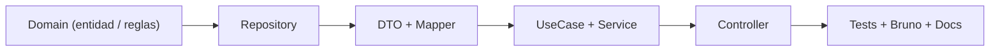
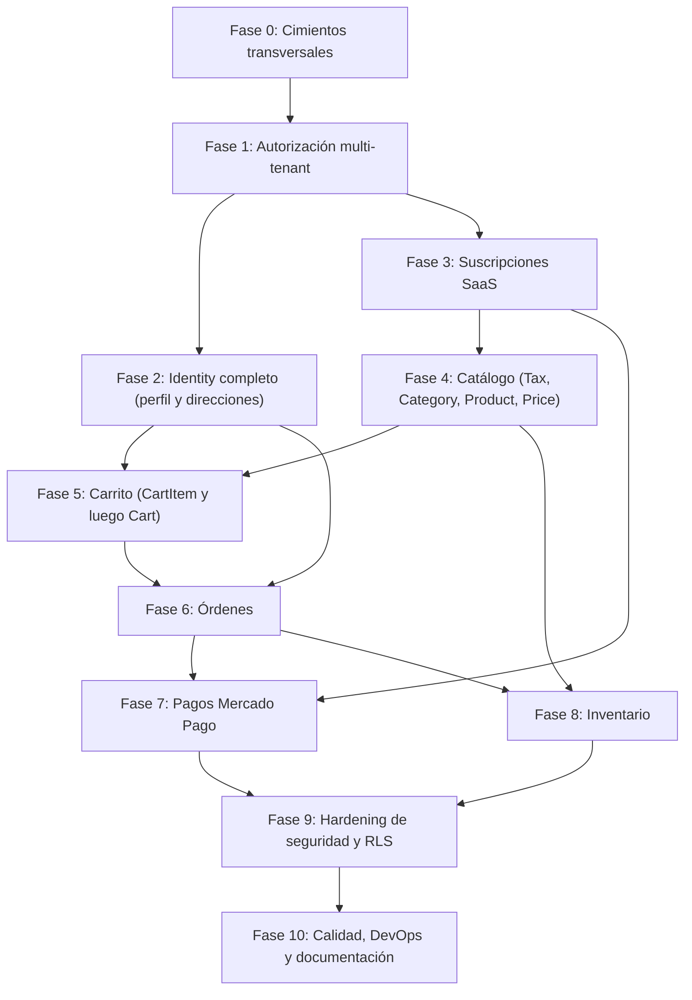

# 🗺️ NexoFood API — Roadmap Incremental de Implementación

> **Objetivo:** listar todo lo que falta implementar en la API (servicios, controladores, seguridad, integraciones y calidad) en un **orden estrictamente incremental**, de forma que **ninguna tarea dependa de algo que aún no exista**.
>
> **Fecha de análisis:** 2026-10-20 · **Base:** estado actual del código en `src/main/java/lat/nexofood/api`, `script.sql` y `PLAN.md`.

---

## 📌 Cómo leer este roadmap

1. Las **fases se ejecutan en orden** (Fase 0 → Fase 10). Una fase solo empieza cuando la anterior cumple su *Definición de Hecho*.
2. Dentro de cada fase, las tareas están numeradas en orden de dependencia (`3.1` antes de `3.2`).
3. Dentro de cada tarea se respeta siempre el mismo flujo por capas:

> [!IMPORTANT]
> **Nunca** se crea un controlador sin que su servicio exista y esté probado, y **nunca** se crea un agregado padre (ej. `Cart`) sin que su hijo (ej. `CartItem`) tenga su lógica lista.

---

## 1. Diagnóstico del estado actual

### 1.1 Matriz de completitud por módulo

| Módulo | Domain | Repository | DTO / Mapper | Service | Controller | Tests |
|---|:-:|:-:|:-:|:-:|:-:|:-:|
| **identity** (auth) | ✅ | ✅ | ✅ | ✅ | ✅ `AuthController` | ✅ |
| **identity** (direcciones / perfil) | ✅ | ✅ | ✅ | ❌ | ❌ | ❌ |
| **store** (tenant / members / customers / store-auth) | ✅ | ✅ | ✅ | ✅ | ✅ | ❌ |
| **subscription** | ✅ | ✅ | ✅ | ❌ | ❌ | ❌ |
| **catalog** – Tax | ✅ | ✅ | ✅ | ✅ `TaxServiceImpl` | ❌ | ✅ (cálculo) |
| **catalog** – Category | ✅ | ✅ | ✅ | ❌ | ❌ | ❌ |
| **catalog** – Product | ✅ | ✅ | ✅ | 🟡 (sin delete / toggle) | ❌ | ❌ |
| **catalog** – ProductPrice | ✅ | ✅ | ✅ | 🟡 (solo pricing, sin CRUD) | ❌ | ✅ (pricing) |
| **cart** (Cart + CartItem) | ✅ | ✅ | ✅ | ❌ | ❌ | 🟡 (solo domain) |
| **order** | ✅ | ✅ | ✅ | 🟡 (`create`, `find`) | ❌ | ✅ (domain / tax) |
| **payment** | ✅ | ✅ | ✅ | ❌ | ❌ | ❌ |
| **inventory** | ✅ | ✅ | ❌ | ❌ | ❌ | 🟡 (solo domain) |

### 1.2 Hallazgos críticos detectados

| # | Hallazgo | Impacto | Se resuelve en |
|---|---|---|---|
| H1 | **Ningún endpoint valida que el usuario pertenezca al tenant** (`@PreAuthorize` = 0 usos). Cualquier usuario autenticado puede editar cualquier restaurante, su staff o sus clientes (IDOR). | 🔴 Crítico | Fase 1 |
| H2 | `CreateTenantService` recibe `ownerId` y `subscriptionId` **desde el body** en vez del token; no valida que la suscripción sea del owner. | 🔴 Crítico | Fase 1 / Fase 3 |
| H3 | `nexofood.crypto.master-key` **no está definida** en `application.yaml` → `CryptoService` falla al iniciar si no existe la env var. | 🔴 Bloqueante | Fase 0 |
| H4 | Secretos JWT con **valores por defecto** en `application.yaml`. | 🔴 Crítico | Fase 0 |
| H5 | `TenantConnectionPreparer` existe pero **no se usa en ningún lado** → las políticas RLS del `script.sql` no tienen efecto (y con usuario `postgres` se ignoran). | 🟠 Alto | Fase 9 |
| H6 | `ddl-auto: update` + `show-sql: true` sin perfiles → riesgo en producción y esquema divergente de `script.sql`. | 🟠 Alto | Fase 0 |
| H7 | `OrderServiceImpl.create` recibe `customerId` como parámetro libre, no valida que la dirección sea del cliente, ni el radio de cobertura PostGIS, ni el `deliveryFee` del tenant. | 🟠 Alto | Fase 6 |
| H8 | `PaymentCreateRequest` acepta `amount` y `rawResponse` **desde el cliente**. | 🔴 Crítico | Fase 7 |
| H9 | `SubscriptionCreateRequest` acepta `userId` desde el body. | 🟠 Alto | Fase 3 |
| H10 | Endpoints usan `Map<String, …>` como body (`/status`, `/role`) y `TenantStaffRole.valueOf()` sin manejo → 500 ante valores inválidos. | 🟡 Medio | Fase 0 / Fase 1 |
| H11 | `CustomUserDetailsService` no considera `deletedAt` (soft delete). | 🟡 Medio | Fase 2 |
| H12 | El `authenticationEntryPoint` devuelve el mensaje interno de la excepción JWT al cliente. | 🟡 Medio | Fase 9 |

---

## 2. Grafo de dependencias entre fases

**Por qué este orden:**

- **Fase 1 antes que cualquier controlador nuevo:** todos los controladores de tenant necesitan la verificación de membresía/rol; si se crean antes, habría que reabrirlos todos.
- **Suscripciones (F3) antes que Catálogo (F4):** el plan define `maxProducts`, que el `ProductService` debe respetar.
- **Direcciones (F2) y Catálogo (F4) antes que Carrito (F5):** el carrito necesita productos con precio vigente y el checkout necesita dirección.
- **Carrito (F5) antes que Órdenes (F6):** la orden se genera a partir del carrito (checkout).
- **Órdenes (F6) antes que Pagos (F7):** un pago siempre referencia una orden y la regla anti-fraude bloquea `EN_PREPARACION` sin pago aprobado.
- **Inventario (F8) después de Órdenes:** el descuento automático de stock (motivo `SALE`) depende del ciclo de vida de la orden.
- **RLS (F9) al final:** activarlo exige que *todos* los flujos establezcan el contexto de tenant; si se activa antes, rompe los módulos aún no terminados.

---

## Fase 0 — Cimientos transversales 🧱

> Todo lo demás depende de esto. Son piezas reutilizables por todos los módulos.

### 0.1 Configuración y perfiles
- [x] Agregar `nexofood.crypto.master-key: ${CRYPTO_MASTER_KEY}` en `application.yaml` (**sin valor por defecto**). *(H3)*
- [x] Quitar los valores por defecto de `JWT_SECRET` y `JWT_SECRET_REFRESH`; fallar al iniciar si no existen. *(H4)*
- [x] Crear perfiles `application-dev.yaml` y `application-prod.yaml` (`show-sql`, `format_sql`, Swagger habilitado solo en dev). *(H6)*
- [x] Crear `.env.example` documentando todas las variables requeridas.

### 0.2 Configuración de persistencia (JPA / Hibernate)
- [x] Configurar adecuadamente `ddl-auto: update` para desarrollo en `application-dev.yaml`.
- [x] Asegurar que las restricciones en anotaciones JPA (`@Column(unique = ..., nullable = ...)`, `@Table(uniqueConstraints = ...)`) reflejen las reglas de negocio de la BD.

### 0.3 Infraestructura común (`common/`)
- [x] `ForbiddenException` + handler 403 en `GlobalExceptionHandler`.
- [x] Handlers faltantes: `HttpMessageNotReadableException`, `MethodArgumentTypeMismatchException`, `DataIntegrityViolationException` (→ 409), `IllegalArgumentException` (→ 400). *(H10)*
- [x] `PageResponse<T>` + convención de paginación (`page`, `size`, `sort`) para todos los listados.
- [x] `SecurityUtils` / `CurrentUserProvider`: obtiene el `User` autenticado (id, email, rol) desde el `SecurityContext`. **Todas las fases lo usan.**

**✅ Definición de Hecho F0:** la app arranca solo con variables de entorno, Hibernate actualiza el esquema automáticamente con las entidades `@Entity`, y existe un helper para obtener el usuario actual.

---

## Fase 1 — Autorización multi-tenant 🔐

> **Depende de:** F0 (`CurrentUserProvider`, `ForbiddenException`).
> Resuelve el hallazgo más grave (H1) **antes** de exponer más endpoints.

### 1.1 Servicio de autorización por tenant
- [x] `TenantMemberRepository`: queries `findByTenantIdAndUserIdAndIsActiveTrue`, `existsByTenantIdAndUserIdAndRoleIn`.
- [x] `TenantAccessService` (bean `@tenantAccess`) con métodos:
  - `isMember(tenantId)`
  - `hasAnyRole(tenantId, TenantStaffRole...)`
  - `isOwner(tenantId)`
  - `isSuperAdmin()`
- [x] Tests unitarios del servicio.

### 1.2 Proteger los controladores existentes
- [x] `TenantController`: `PUT /{id}` y `PATCH /{id}/status` → solo `OWNER` / `SUPERADMIN`.
- [x] `TenantMemberController`: listar → `OWNER`/`ADMIN`; agregar/cambiar rol/eliminar → `OWNER`/`ADMIN` (un `ADMIN` no puede tocar al `OWNER`; el `OWNER` no puede eliminarse a sí mismo).
- [x] `TenantCustomerController`: → `OWNER`/`ADMIN`.
- [x] Reemplazar `Map<String, Boolean>` y `Map<String, String>` por DTOs validados: `TenantStatusRequest`, `MemberRoleUpdateRequest`. *(H10)*

### 1.3 Corregir la creación de tenant
- [x] `CreateTenantService`: el `owner` sale del token (`CurrentUserProvider`), **no** del body. Eliminar `ownerId` de `TenantCreateRequest`. *(H2)*
- [x] Validar que la suscripción pertenezca al usuario autenticado.

**✅ Definición de Hecho F1:** un usuario que no es miembro del tenant recibe **403** en todos los endpoints de `/tenants/{id}/**` y `/admin/tenants/{id}/**`. Tests de integración que lo comprueban.

---

## Fase 2 — Identity completo 👤

> **Depende de:** F0, F1. Necesario antes del carrito/checkout (direcciones).

### 2.1 Direcciones del cliente (`CustomerAddress`)
- [x] Servicios/UseCases: `CreateAddress`, `GetMyAddresses`, `UpdateAddress`, `DeleteAddress` (siempre filtrando por el usuario autenticado).
- [x] Validar coordenadas con `GeoUtils`.
- [x] Controller: `/api/v1/users/me/addresses` (CRUD).

### 2.2 Perfil y sesión del usuario
- [x] `UpdateProfileService` (usa `UserUpdateRequest` existente).
- [x] `ChangePasswordService` (verifica password actual y **revoca todos los refresh tokens**).
- [x] `LogoutService`: revoca el refresh token actual (`POST /api/v1/auth/logout`).
- [x] Soft delete de cuenta (`deletedAt`) + `CustomUserDetailsService` y `LoginService` rechazan usuarios borrados. *(H11)*
- [x] Endpoints en `AuthController` / `UserController` (`PUT /users/me`, `PATCH /users/me/password`, `DELETE /users/me`).

### 2.3 (Opcional) Gestión de usuarios para `SUPERADMIN`
- [x] Listar / activar / desactivar usuarios: `/api/v1/admin/users`.

**✅ Definición de Hecho F2:** un cliente puede gestionar sus direcciones y su perfil; un usuario eliminado no puede iniciar sesión.

---

## Fase 3 — Suscripciones SaaS 💳

> **Depende de:** F1 (roles `SUPERADMIN`). Debe existir antes de F4 (límite `maxProducts`) y de la creación correcta de tenants.

### 3.1 Planes (`SubscriptionPlan`)
- [x] `SubscriptionPlanService`: CRUD + activar/desactivar.
- [x] Controller: `GET /api/v1/plans` (público, solo activos) y `/api/v1/admin/plans` (`SUPERADMIN`).

### 3.2 Suscripciones (`Subscription`)
- [x] `SubscriptionService`: `startTrial(planId)`, `getMySubscription()`, `cancel()`. El usuario sale del token; eliminar `userId` de `SubscriptionCreateRequest`. *(H9)*
- [x] Controller: `/api/v1/subscriptions` (`POST`, `GET /me`, `PATCH /me/cancel`).

### 3.3 Integración con Tenant
- [x] `CreateTenantService` usa la suscripción vigente del usuario (ya no se envía por body).
- [x] `SubscriptionGuard`: método reutilizable `assertActive(tenantId)` y `getLimits(tenantId)`.

### 3.4 Expiración automática
- [x] `@EnableScheduling` + job diario: `TRIAL`/`ACTIVE` vencidas → `EXPIRED`/`PAST_DUE` y tenant `isActive = false`.

> [!NOTE]
> El cobro recurrente con Mercado Pago (preapproval) se implementa en **Fase 7.5**, porque requiere la integración con MP.

**✅ Definición de Hecho F3:** un usuario puede iniciar un trial, crear su restaurante con él, y el tenant se desactiva al vencer.

---

## Fase 4 — Catálogo 🍔

> **Depende de:** F1 (autorización), F3 (`maxProducts`).
> Orden interno: **Tax → Category → Product → ProductPrice → Menú público**, porque `Product` referencia a `Tax` y `Category`, y `ProductPrice` referencia a `Product`.

### 4.1 Impuestos (`Tax`) — el servicio ya existe
- [ ] Tests unitarios de `TaxServiceImpl`.
- [ ] `TaxController`: `/api/v1/tenants/{tenantId}/taxes` (CRUD + toggle) protegido con `OWNER`/`ADMIN`.

### 4.2 Categorías (`Category`)
- [ ] `CategoryRepository`: `findAllByTenantIdOrderBySortOrder`, `existsByTenantIdAndNameIgnoreCase`.
- [ ] `CategoryService`: crear, actualizar, activar/desactivar, reordenar (`sortOrder`), eliminar (bloquear si tiene productos).
- [ ] `CategoryController`: `/api/v1/tenants/{tenantId}/categories`.

### 4.3 Productos (`Product`) — completar el servicio existente
- [ ] Agregar a `ProductService`: `toggleAvailability`, `delete` (soft: `isAvailable=false`), listado paginado y filtrado por categoría.
- [ ] Validar límite `maxProducts` del plan usando `SubscriptionGuard` (F3.3).
- [ ] `ProductController`: `/api/v1/tenants/{tenantId}/products`.

### 4.4 Reglas de precio (`ProductPrice`)
- [ ] `ProductPriceService`: agregar / editar / eliminar reglas de un producto.
- [ ] Validaciones: exactamente **un precio base** activo por producto, rangos de fecha/hora coherentes, sin solapamientos ambiguos.
- [ ] Endpoints anidados: `/api/v1/tenants/{tenantId}/products/{productId}/prices`.

### 4.5 Menú público (storefront)
- [ ] `StorefrontMenuService`: categorías activas + productos disponibles con **precio vigente** calculado por `ProductPricingService` e impuesto.
- [ ] Controller público: `GET /api/v1/store/{slug}/menu` y `GET /api/v1/store/{slug}/products/{id}` (añadir a `permitAll` en `SecurityConfig`).

### 4.6 (Opcional) Subida de imágenes
- [ ] `StorageService` (Supabase Storage) para `logoUrl`, `bannerUrl`, `imageUrl` con validación de tipo/tamaño.

**✅ Definición de Hecho F4:** el admin gestiona su catálogo completo y el storefront muestra el menú con precios dinámicos correctos.

---

## Fase 5 — Carrito 🛒

> **Depende de:** F2 (cliente autenticado), F4 (productos y precios).
> Orden interno obligatorio: **resolución del cliente → CartItem → Cart → Controller**.

### 5.1 Resolución del cliente de tienda
- [ ] `CurrentCustomerResolver`: a partir del token + `slug` obtiene el `TenantCustomer` (o lo crea si el usuario existe pero aún no es cliente de esa tienda). Rechaza clientes **bloqueados** (`isBlocked`).

### 5.2 Lógica de dominio de `CartItem` y `Cart`
- [ ] `CartItem`: `increaseQuantity`, `updateQuantity` (validar `> 0`), `repriceTo(BigDecimal)`, `calculateSubtotal()` en memoria (el subtotal real lo genera la BD).
- [ ] `Cart`: `addItem` (fusiona si el producto ya existe), `removeItem`, `clear`, `calculateTotal()` en memoria.
- [ ] Ampliar `CartTest` con estos comportamientos.

### 5.3 `CartItemService` (primero el hijo)
- [ ] `AddCartItem`: valida que el producto pertenezca al tenant del carrito, esté disponible, y congela `unitPrice` con `ProductPricingService`.
- [ ] `UpdateCartItemQuantity`, `RemoveCartItem`, `UpdateCartItemNotes`.

### 5.4 `CartService` (después el padre)
- [ ] `GetOrCreateCart(tenant, customer)` (respeta `uk_carts_tenant_customer`).
- [ ] `GetMyCart` → **re-calcula precios** vigentes al leer (los precios son dinámicos) e informa si alguno cambió o el producto dejó de estar disponible.
- [ ] `ClearCart`, `UpdateCartNotes`.

### 5.5 `CartController`
- [ ] `GET /api/v1/store/{slug}/cart`
- [ ] `POST /api/v1/store/{slug}/cart/items`
- [ ] `PATCH /api/v1/store/{slug}/cart/items/{itemId}`
- [ ] `DELETE /api/v1/store/{slug}/cart/items/{itemId}`
- [ ] `DELETE /api/v1/store/{slug}/cart`

**✅ Definición de Hecho F5:** un cliente puede armar su carrito en una tienda; nunca puede agregar productos de otra tienda ni manipular precios.

---

## Fase 6 — Órdenes 📦

> **Depende de:** F5 (checkout desde carrito), F2 (direcciones).

### 6.1 Corregir `OrderServiceImpl.create` *(H7)*
- [ ] El cliente se obtiene con `CurrentCustomerResolver`, no como parámetro libre.
- [ ] Validar tenant activo y suscripción vigente (`SubscriptionGuard`).
- [ ] Validar que `customerAddressId` pertenezca al usuario autenticado.
- [ ] Validar cobertura con PostGIS (`ST_DistanceSphere` vs `deliveryRadiusKm`) para `DELIVERY`; `PICKUP` no requiere dirección.
- [ ] Tomar `deliveryFee` de `tenant.defaultDeliveryFee`.

### 6.2 Número de orden secuencial
- [ ] Reemplazar `generateOrderNumber` (timestamp + random) por un correlativo por tenant (tabla/secuencia `tenant_order_sequences` con bloqueo), respetando `UNIQUE(tenant_id, order_number)`.

### 6.3 Checkout desde carrito
- [ ] `CheckoutService.createFromCart(slug, request)`: re-precia los ítems del carrito, crea la orden con snapshots inmutables y **vacía el carrito** en la misma transacción.

### 6.4 Máquina de estados
- [ ] `OrderStateMachine` con transiciones permitidas:
  `PENDIENTE → EN_PREPARACION → LISTO_PARA_ENTREGA → EN_CAMINO → ENTREGADO` y `PENDIENTE/EN_PREPARACION → CANCELADO`.
- [ ] Validación por rol: `COCINERO` (preparación/listo), `REPARTIDOR` (en camino/entregado), `ADMIN`/`OWNER` (todo + cancelar).
- [ ] Asignar `deliveryStaff` (debe ser miembro `REPARTIDOR` activo del tenant).
- [ ] Dejar un punto de extensión `PaymentGuard` para la transición a `EN_PREPARACION` (se implementa en F7.4).

### 6.5 Consultas
- [ ] Cliente: historial de sus órdenes y detalle (solo las propias).
- [ ] Admin: listado paginado con filtros (estado, fecha, tipo de entrega).
- [ ] KDS (cocina): órdenes `EN_PREPARACION` ordenadas por antigüedad.
- [ ] Repartidor: órdenes asignadas.

### 6.6 Controladores
- [ ] Storefront: `POST /api/v1/store/{slug}/orders/checkout`, `GET /api/v1/store/{slug}/orders`, `GET /api/v1/store/{slug}/orders/{id}`.
- [ ] Admin: `/api/v1/tenants/{tenantId}/orders` (listar, detalle, `PATCH /{id}/status`, `PATCH /{id}/assign`).

### 6.7 Fidelización
- [ ] Al pasar a `ENTREGADO`, sumar `loyaltyPoints` al `TenantCustomer` (las estadísticas `totalOrders/first/last` ya las mantiene el trigger).

**✅ Definición de Hecho F6:** flujo completo carrito → orden → entrega funcionando, con roles respetados y sin datos manipulables por el cliente.

---

## Fase 7 — Pagos con Mercado Pago 💰

> **Depende de:** F6 (órdenes), F3 (suscripciones para 7.5).

### 7.1 Conexión OAuth del restaurante
- [ ] Agregar SDK `mercadopago-sdk-java` y propiedades `mp.client-id`, `mp.client-secret`, `mp.redirect-uri`, `mp.webhook-secret`.
- [ ] `MercadoPagoOAuthService`: `connect` (URL de autorización con `state` firmado), `callback` (intercambia `code` por tokens, guardados cifrados vía `EncryptedStringConverter`), `refreshToken`, `disconnect`.
- [ ] Controller: `/api/v1/tenants/{tenantId}/mercadopago/*` (solo `OWNER`).

### 7.2 Creación del pago
- [ ] `PaymentService.createPreference(orderId)`: el **monto sale de `order.total`**, nunca del cliente. Eliminar `amount` y `rawResponse` de `PaymentCreateRequest`. *(H8)*
- [ ] Persistir `Payment` en `PENDING` con `mpPreferenceId`.
- [ ] Endpoint storefront: `POST /api/v1/store/{slug}/orders/{id}/pay`.

### 7.3 Webhook
- [ ] `POST /api/v1/webhooks/mercadopago` (público) con validación de firma `x-signature`.
- [ ] Idempotencia por `mpPaymentId`; consultar el pago a la API de MP (no confiar en el body).
- [ ] Sanitizar `raw_response` antes de guardar (lista blanca de campos, ver `PLAN.md` §1.3).

### 7.4 Integración con la orden
- [ ] Implementar `PaymentGuard`: solo `APPROVED` permite `PENDIENTE → EN_PREPARACION` (regla anti-fraude).
- [ ] Al cancelar una orden pagada → reembolso vía API de MP y `Payment.status = REFUNDED`.

### 7.5 Cobro recurrente de suscripciones
- [ ] Preapproval de MP (cuenta de la plataforma) al pasar de `TRIAL` a `ACTIVE`; webhook de preapproval actualiza `SubscriptionStatus`.

**✅ Definición de Hecho F7:** ninguna orden entra a cocina sin pago aprobado confirmado por webhook verificado.

---

## Fase 8 — Inventario 📊

> **Depende de:** F4 (catálogo, para la receta opcional), F6 (ventas).
> Orden interno: **Item → Stock → Movement**, porque el stock referencia al item y el movimiento referencia al stock.

### 8.1 DTOs y mappers
- [ ] Crear `InventoryItemRequest/Response`, `InventoryStockRequest/Response`, `InventoryMovementRequest/Response` + mappers (el módulo no tiene capa `web`).

### 8.2 Insumos (`InventoryItem`)
- [ ] `InventoryItemService`: CRUD, SKU único por tenant, activar/desactivar.
- [ ] Controller: `/api/v1/tenants/{tenantId}/inventory/items`.

### 8.3 Existencias (`InventoryStock`)
- [ ] `InventoryStockService`: crear stock por item/ubicación, actualizar `minimumStock`, alertas de stock bajo.
- [ ] Controller: `/api/v1/tenants/{tenantId}/inventory/stocks`.

### 8.4 Movimientos / Kardex (`InventoryMovement`)
- [ ] `InventoryMovementService.register(...)`: **única vía** para modificar `quantity`. Bloqueo pesimista (`SELECT … FOR UPDATE`), calcula `previousQuantity`/`newQuantity`, `performedBy` desde el token, valida stock no negativo.
- [ ] Validar coherencia `movementType` ↔ `reason` (ej. `PURCHASE` solo `ENTRY`).
- [ ] Controller: `POST /inventory/movements`, `GET /inventory/stocks/{id}/kardex` (paginado).

### 8.5 (Opcional) Recetas y descuento automático
- [ ] Nueva tabla `product_ingredients (product_id, inventory_item_id, quantity)` + entidad.
- [ ] Al pasar la orden a `EN_PREPARACION`, registrar movimientos `EXIT / SALE` por cada ingrediente; al cancelar, `ENTRY / CUSTOMER_RETURN`.

**✅ Definición de Hecho F8:** el stock solo cambia mediante movimientos auditables y nunca queda negativo bajo concurrencia.

---

## Fase 9 — Hardening de seguridad 🛡️

> **Depende de:** todas las fases funcionales (F1–F8). Se hace al final porque activar RLS exige que **todos** los flujos establezcan el contexto de tenant.

### 9.1 Activar Row Level Security *(H5)*
- [ ] `TenantContext` (ThreadLocal) poblado por un interceptor a partir del `tenantId`/`slug` del path.
- [ ] Aspecto/`TransactionSynchronization` que invoque `TenantConnectionPreparer` al inicio de cada transacción.
- [ ] Cambiar la concatenación de `SET LOCAL` por `SELECT set_config('app.current_tenant_id', :id, true)` parametrizado.
- [ ] Crear rol de BD `nexofood_app` **sin** `SUPERUSER` ni `BYPASSRLS`; usar `FORCE ROW LEVEL SECURITY`.
- [ ] Tests de integración que intenten leer datos de otro tenant.

### 9.2 Protección de autenticación
- [ ] Rate limiting (Bucket4j) en `login`, `register`, `refresh` y `store/*/auth/*`.
- [ ] Bloqueo temporal de cuenta tras N intentos fallidos.
- [ ] Política de contraseñas y normalización de email (`lowercase/trim`).

### 9.3 JWT
- [ ] Claims `iss`/`aud` y validación del tipo de token (access vs refresh).
- [ ] `tokenVersion` en el usuario para invalidar access tokens al cambiar contraseña.
- [ ] Job de limpieza de refresh tokens expirados/revocados.

### 9.4 Respuestas y cabeceras
- [ ] No exponer mensajes internos en 401/403/500. *(H12)*
- [ ] Cabeceras de seguridad (HSTS, `X-Content-Type-Options`, `Referrer-Policy`).
- [ ] Swagger deshabilitado en `prod`; CORS por perfil.

### 9.5 Auditoría y observabilidad
- [ ] `spring-boot-starter-actuator` con endpoints protegidos.
- [ ] Log de auditoría para acciones sensibles (cambios de rol, bloqueos, cambios de precio, cancelaciones, conexión MP).
- [ ] Escaneo de dependencias (OWASP Dependency-Check).

**✅ Definición de Hecho F9:** aun con un bug en un servicio, la BD impide fugas entre tenants; los endpoints de auth resisten fuerza bruta.

---

## Fase 10 — Calidad, DevOps y documentación 🚀

> Transversal: los tests y la colección Bruno se escriben **en cada fase**, pero aquí se consolida la infraestructura.

- [ ] Tests de integración con **Testcontainers** (imagen `postgis/postgis`).
- [ ] Cobertura mínima (JaCoCo) por módulo.
- [ ] Colecciones Bruno por módulo (`Store`, `Catalog`, `Cart`, `Order`, `Payment`, `Inventory`, `Subscription`).
- [ ] Actualizar `docs/API_DOCUMENTATION.md` y anotaciones OpenAPI de cada controlador nuevo.
- [ ] `Dockerfile` multi-stage + `docker-compose.yml` (API + PostGIS).
- [ ] Pipeline CI (GitHub Actions): build, tests, dependency-check.

---

## 📋 Resumen ejecutivo (checklist de orden)

| Orden | Fase | Entregable clave | Bloquea a |
|:-:|---|---|---|
| 0 | Cimientos | Config segura, `ddl-auto: update`, `CurrentUserProvider`, handlers | Todas |
| 1 | Autorización | `TenantAccessService` + controladores protegidos | 2, 3 |
| 2 | Identity | Direcciones, perfil, logout, soft delete | 5, 6 |
| 3 | Suscripciones | Planes, trial, expiración, `SubscriptionGuard` | 4, 7 |
| 4 | Catálogo | Tax → Category → Product → Price → Menú público | 5, 8 |
| 5 | Carrito | CartItem → Cart → `CartController` | 6 |
| 6 | Órdenes | Checkout, estados, roles, cobertura PostGIS | 7, 8 |
| 7 | Pagos | OAuth MP, preferencia, webhook, anti-fraude | 9 |
| 8 | Inventario | Item → Stock → Movement (Kardex) | 9 |
| 9 | Hardening | RLS activo, rate limit, JWT robusto | 10 |
| 10 | Calidad | Testcontainers, CI, Docker, docs | — |
